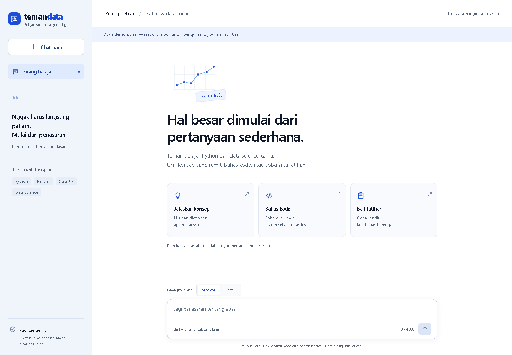
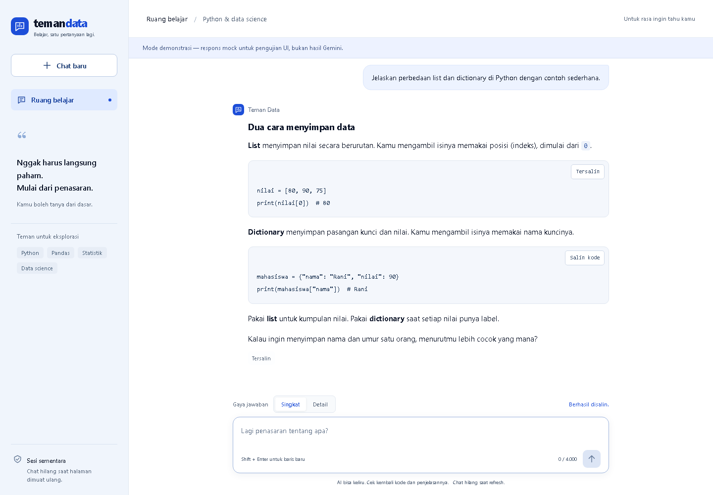

# Teman Data

Chatbot belajar Python dan data science untuk mahasiswa dan pemula. Dibuat sebagai Final Project seminar Hacktiv8, menggunakan **Flask + Gemini API** dan frontend HTML/CSS/JavaScript tanpa build tools.

## Masalah dan pengguna

Pemula sering memahami potongan sintaks tetapi belum memahami kapan memakainya. Teman Data membantu menjelaskan konsep dengan contoh kecil, membahas alur dan kesalahan kode, serta memberi satu latihan diikuti feedback. Targetnya mahasiswa atau peserta pelatihan yang baru belajar Python, pandas, statistik dasar, dan data science.

## Fitur

- Tiga pembuka: **Jelaskan konsep**, **Bahas kode**, dan **Beri latihan**. Klik mengisi input, bukan langsung mengirim.
- Pilihan **Singkat / Detail** yang mengubah instruksi tutor.
- Konteks maksimal enam pasangan percakapan terakhir, tanpa database/login.
- Markdown, blok kode, salin kode/jawaban, error yang bisa dicoba ulang, dan konfirmasi chat baru.
- UI terang dan responsif; tombol keyboard, reduced motion, dan semua aset lokal.
- API key, model, temperature, dan batas output dikonfigurasi melalui `.env` di backend.

Kode pengguna **tidak dieksekusi**. Aplikasi tidak mempunyai akses web, upload file, RAG, atau agent. Refresh halaman menghapus percakapan; tab yang berbeda memiliki sesi masing-masing. Pengaturan `.env` memerlukan restart server.

## Jalankan di Windows

Prasyarat: Python **3.10 atau lebih baru**, internet untuk Gemini, dan API key sendiri dari [Google AI Studio](https://aistudio.google.com/apikey).

Buka PowerShell di folder proyek ini:

```powershell
cd 'E:\AI\Codex\Hacktiv8 Final Project\Output\teman-data'
py -3 -m venv .venv
.\.venv\Scripts\python.exe -m pip install -r requirements.txt
```

Salin `.env.example` menjadi `.env` jika belum ada. File `.env` kosong sudah disediakan pada workspace awal; isi key melalui editor. Jangan menimpa `.env` yang sudah berisi key.

```dotenv
GEMINI_API_KEY=isi_key_milikmu
GEMINI_MODEL=gemini-3.5-flash
GEMINI_TEMPERATURE=1.0
GEMINI_MAX_OUTPUT_TOKENS=4096
```

Kemudian:

```powershell
.\.venv\Scripts\python.exe app.py
```

Buka **http://127.0.0.1:5000**. Hentikan dengan `Ctrl+C`. Tidak perlu mengaktifkan virtual environment atau mengubah PowerShell ExecutionPolicy. Virtual environment yang sudah dibuat di workspace ini dapat langsung digunakan.

Di Linux/macOS, buat environment dengan `python3 -m venv .venv`, lalu gunakan `.venv/bin/python` untuk command yang sama.

## Konfigurasi

| Variabel | Default | Keterangan |
|---|---|---|
| `GEMINI_API_KEY` | Kosong | Wajib untuk chat nyata; tidak dikirim ke browser |
| `GEMINI_MODEL` | `gemini-3.5-flash` | Model harus tersedia untuk project/key kamu |
| `GEMINI_TEMPERATURE` | `1.0` | Angka 0–2; bukan jaminan kebenaran jawaban |
| `GEMINI_MAX_OUTPUT_TOKENS` | `4096` | Batas 256–8192; token thinking juga dapat memakai anggaran model |

Environment variable sistem lebih diprioritaskan daripada `.env`. Tidak ada perpindahan model otomatis atau retry otomatis ke provider. Request Gemini memiliki timeout 60 detik; browser memberi waktu 65 detik. Output yang terpotong ditampilkan sebagai error dengan petunjuk, bukan dianggap sebagai jawaban lengkap.

Per 27 September 2026, [pricing Gemini](https://ai.google.dev/gemini-api/docs/pricing#gemini-3.5-flash) mencantumkan free tier standar untuk model ini. Kuota dan akses aktual mengikuti project kamu; jangan menganggap gratis tanpa batas. Pesan dan konteks terkirim ke Google ketika chat nyata digunakan. Aplikasi tidak menyimpan percakapan ke database atau file; kebijakan data provider tetap berlaku.

## Struktur dan alur

```text
app.py                 Routing Flask, validasi, sanitasi Markdown
config.py              Pembacaan dan validasi .env
prompts.py             Persona serta instruksi Singkat/Detail
services/gemini.py     Batas integrasi Gemini dan pemetaan error
templates/index.html  Halaman chat
static/                CSS, JavaScript, favicon lokal
tests/                 Backend tests dan fixture/browser checks
screenshots/           Empat screenshot demonstrasi berlabel mock
```

Browser mengirim `POST /api/chat` berupa:

```json
{
  "message": "Beri contoh list",
  "history": [
    {"role": "user", "content": "Apa itu list?"},
    {"role": "assistant", "content": "List adalah kumpulan nilai berurutan."}
  ],
  "detail": "singkat"
}
```

Backend memvalidasi input (maksimal 4.000 karakter), mengambil enam pasangan konteks terakhir, menambahkan system instruction, lalu menghubungi Gemini. Respons sukses berisi `reply` (teks Markdown) dan `html` (hasil Markdown yang disanitasi). Error berisi `error.code` dan `error.message`; tidak mengembalikan secret atau detail exception provider. Riwayat hanya diperbarui setelah respons berhasil, sehingga retry tidak menggandakan pesan.

Aplikasi secara default hanya menerima host localhost/127.0.0.1 dan tidak mengaktifkan CORS. Server Flask ini ditujukan untuk demo lokal, bukan deployment publik.

## Pengujian

```powershell
.\.venv\Scripts\python.exe -m pip install -r requirements-dev.txt
.\.venv\Scripts\python.exe -m pytest -q
```

Tes backend menggunakan provider mock dan HTTP transport mock untuk SDK asli; **tidak memakai key atau kuota Gemini**. Mencakup validasi input/history, enam pasangan konteks, konfigurasi, timeout, key/model/kuota, respons kosong/terpotong, sanitasi HTML, dan perlindungan secret.

Browser checks opsional:

```powershell
.\.venv\Scripts\python.exe -m pip install -r requirements-ui.txt
.\.venv\Scripts\python.exe -m playwright install chromium
.\.venv\Scripts\python.exe tests/ui_check.py
```

Script menyalakan fixture offline pada port 5051, menguji UI, mengambil screenshot, lalu menghentikan fixture. Memerlukan port 5051 kosong. Fixture menggunakan respons tetap dan banner **Mode demonstrasi**; `app.py` tidak mengaktifkan fallback mock ketika Gemini gagal.

Untuk melihat fixture sendiri: `.\.venv\Scripts\python.exe tests/demo_server.py`, lalu buka http://127.0.0.1:5051.

### Status verifikasi

- 33 tes backend lulus, termasuk serialisasi request melalui SDK asli dengan HTTP transport offline.
- 11 kelompok browser checks lulus di Chromium: alur chat, history, loading, retry/edit, reset, clipboard, XSS, refresh, input, dan responsive.
- Layout diperiksa pada lebar 375, 768, 1024, dan 1440 px. Empat screenshot desktop/mobile diperiksa secara visual.
- **Gemini nyata belum diverifikasi**, karena API key belum tersedia saat pengerjaan.

### Smoke test setelah key diisi

1. Tanyakan perbedaan list dan dictionary. Pastikan penjelasan relevan dan kode terbaca.
2. Lanjutkan dengan “Kapan aku pakai yang kedua?” untuk memeriksa konteks.
3. Pilih Detail dan minta contoh pemakaian.
4. Mulai chat baru, minta satu latihan, lalu jawab. Pastikan tutor menunggu jawaban sebelum memberi feedback.
5. Ambil screenshot percakapan nyata untuk menggantikan screenshot mock jika ingin menggunakannya sebagai bukti fungsi AI dalam pengumpulan.

## Screenshot dan pengumpulan

Semua screenshot bawaan merupakan **demonstrasi UI dengan mock, bukan bukti hasil Gemini**.





Versi mobile ada di `screenshots/03-mobile-awal-mock.png` dan `screenshots/04-mobile-percakapan-mock.png`.

Sesuai brief seminar, deliverable adalah URL repositori GitHub dan screenshot UI. Folder ini siap dijadikan repo tersendiri, tetapi **belum diunggah atau dideploy**. Sebelum upload, pastikan `.env` dan `.venv` tidak ikut (sudah dicakup `.gitignore`); unggah source, README, requirements, tests, dan screenshot.

## Referensi

- Materi lokal `Session 3/Final Project - Data Scientist.pdf` dan notebook seminar pada folder `ipynb` (tidak diperlukan untuk menjalankan aplikasi).
- [Dokumentasi Flask](https://flask.palletsprojects.com/en/stable/)
- [SDK Google GenAI Python](https://googleapis.github.io/python-genai/)

Dependensi langsung dipin pada versi yang diuji. `requirements-lock.txt` mencatat seluruh environment backend/test yang diverifikasi di Windows Python 3.10; gunakan file ini jika memerlukan versi transitif yang sama.
